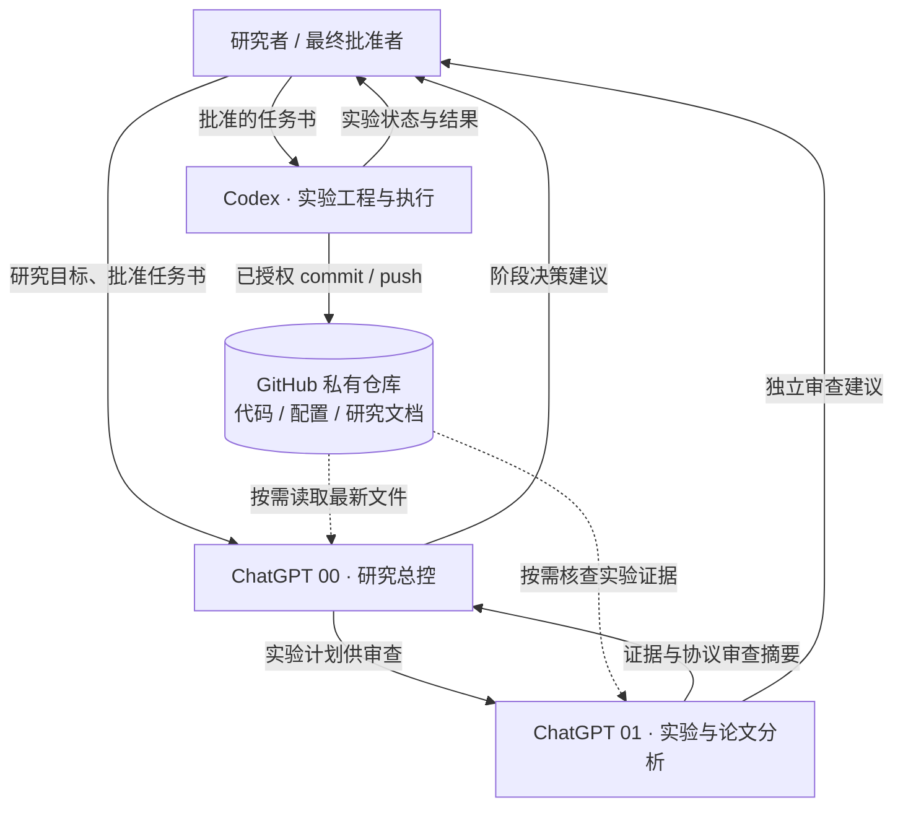
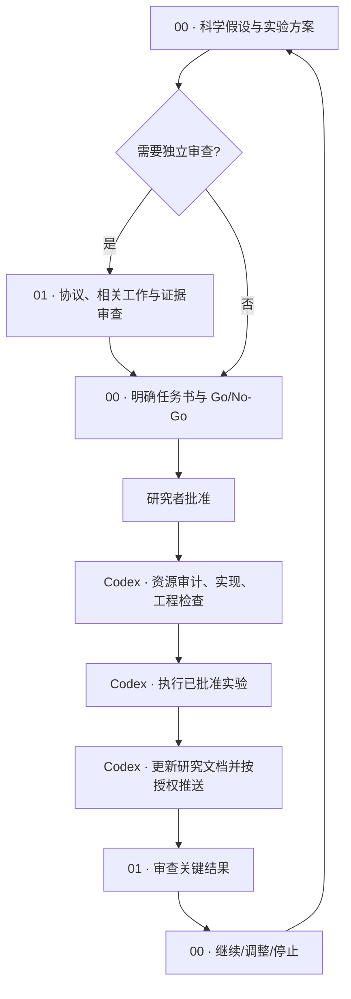

# 基于 ChatGPT 与 Codex 的长期科研工作流

> **从单条超长 Codex 会话，迁移到可追溯、可交接、可持续迭代的科研协作体系。**
>
> 适用：机器学习、深度学习、生理时序、计算机视觉等需要长期实验、反复审查和多轮研究决策的项目。
>
> 版本：v1.0 · 2026-10-30 · **独立实践教程，非 OpenAI 官方操作规范**

这个教程解决一个常见问题：科研项目最初由一条 Codex 对话完成选题、读论文、写代码、做实验和记录结果。项目持续数月后，会话很长，历史实验难以定位，模型容易混淆**讨论过的设想**和**真正跑过的实验**；新会话又需要反复介绍背景。

这里提出一个轻量方案：将研究事实沉淀到版本化文件，把科研决策、学术证据审查和工程执行分开。**不是构建一个自动互相通信的多代理系统**，而是建立能通过文件与任务书交接的人机协作工作流。

## 目录

- [0. 一分钟理解](#0-一分钟理解)
- [1. 角色与信息架构](#1-角色与信息架构)
- [2. 从旧 Codex 迁移：六步](#2-从旧-codex-迁移六步)
- [3. 文档怎么维护](#3-文档怎么维护)
- [4. 日常科研闭环与提问路由](#4-日常科研闭环与提问路由)
- [5. GitHub 私有仓库的安全同步](#5-github-私有仓库的安全同步)
- [6. 迁移验收与常见问题](#6-迁移验收与常见问题)
- [7. 直接复制的初始化提示词](#7-直接复制的初始化提示词)
- [8. 官方参考资料](#8-官方参考资料)

## 0. 一分钟理解

原有模式：

```text
一条长期 Codex 对话
  ├── 研究决策
  ├── 论文分析
  ├── 代码实现/训练
  ├── 各轮实验结果
  └── 依赖聊天上下文保存历史
```

迁移后的模式：



**一句话：00 判断“值不值得做”，01 判断“证据够不够”，Codex 负责“正确执行并记录真实结果”；研究者拥有最终决策权。**

最重要的两条规则：

1. **项目事实不再依赖某一条对话。** 当前状态、历史实验和工程约定都落在仓库里。
2. **GitHub 是版本化的研究记录入口，不是事实的最终裁判。** 具体事实有争议时，以实际执行代码、冻结配置、日志、原始结果为证据。

### 目录结构

```text
research-project/
├── AGENTS.md                  # Codex 的稳定工作约定
├── README.md                  # 复现说明与项目入口
├── docs/
│   ├── research_status.md     # 当前研究状态：精炼、不断维护
│   └── experiment_log.md      # 历史实验台账：保留正负结果
├── src/                       # 项目代码（目录按现有项目调整）
├── configs/                   # 实验配置
└── scripts/                   # 训练/评估脚本
```

上述 `docs/` 文件名是**推荐约定**，不是 Codex 的内置要求。模板见 [templates](templates/)；Codex 能识别适用的 `AGENTS.md`。[官方说明](https://developers.openai.com/cookbook/examples/codex/iterating-development-workflows-with-codex)

## 1. 角色与信息架构

| 组件 | 应该负责 | 不应该负责 |
|---|---|---|
| **ChatGPT 00 · 研究总控** | 研究问题、可证伪假设、创新性、实验优先级、Go/No-Go、实验任务书 | 指挥每一处代码实现和日常 Bug 修复 |
| **ChatGPT 01 · 实验与论文分析** | 文献精读、方法核查、协议审查、消融、统计、负面结果分析 | 未经讨论直接推翻整个项目方向 |
| **Codex** | 查代码、验证资源、实现/训练/评估、工程自查、实验台账与 Git 操作 | 未授权改变关键科研协议，或替研究者决定重大问题 |
| **GitHub（私有）** | 版本化保存代码、配置、研究状态与证据索引 | 自动运行实验、自动把项目文件更新到 ChatGPT「来源」 |
| **研究者** | 目标选择、确认重要方法与资源投入、批准不可逆操作、决定是否公开 | 每次亲自处理重复的代码和文件操作 |

**00、01 是你人为命名的两条 Project 对话，不是可直接互相发消息的后台 Agent。** 对话之间共享已授权的项目上下文，但最新分析应通过任务书、审核摘要、仓库文件等明确传递；不要假定另一条对话已经读到了刚发出的消息。

### 信息分层

- **稳定规则**：ChatGPT Project instructions（科研讨论规则）和代码仓库 `AGENTS.md`（Codex 执行规则）。
- **动态研究事实**：`research_status.md`（最新状态）+ `experiment_log.md`（完整重要历史）。
- **具体任务**：00 生成、研究者确认的实验任务书；Codex 负责执行。
- **原始证据**：配置、代码版本、日志、预测和评估输出。文档指向证据，不用复制所有大型原始文件。

## 2. 从旧 Codex 迁移：六步

### Step 1 · 旧 Codex 固化研究知识

在**已经长期工作的旧 Codex 对话**中发送 [Prompt 01：研究审计与交接](prompts/01-legacy-codex-handoff.md)。

让它检查实际仓库和历史对话，生成或修订 `docs/research_status.md`、`docs/experiment_log.md` 与 `AGENTS.md`。必须保留负面实验、协议纠错、尚未核查的部分，不要“美化”研究进展。

**完成门槛：**新会话无需阅读旧聊天即可定位当前模型、基线、最近实验、关键风险和下一步。

> 旧 Codex 对话**保留为历史档案，不需要删除**；完成交接后不要继续与新会话并行修改同一批文件。

### Step 2 · 建立 ChatGPT Project

新建与研究方向对应的 ChatGPT Project（例如 `Project A Research`），在项目设置中加入 [Project instructions 模板](prompts/05-project-instructions.md)。

在尚未建立 GitHub 读取能力时，可把两份 Markdown 放入 Project **「来源（Sources）」**，帮助首次恢复研究基线。它们属于上传时的文件快照，不会因 Codex 修改本地文件而自动更新。

### Step 3 · 初始化两条专用对话

在同一 ChatGPT Project 创建：

- **`00 · 研究总控`**：发送 [Prompt 02](prompts/02-chatgpt-00-research-control.md)，先建立科学问题、假设与近期实验决策的基线。
- **`01 · 实验与论文分析`**：发送 [Prompt 03](prompts/03-chatgpt-01-experiment-review.md)，先建立数据协议、基线、统计与结果审查的基线。

**验收方式：**让两条对话分别说明当前研究状态。若它们把“仅设计”当作“实验完成”，应先返回项目文件核对，而不是立即推进训练。

### Step 4 · 在原项目目录新建 Codex 对话

不需要转移代码，更不要求在 VS Code 里重新打开项目。仍在**原目录**创建新 Codex 对话，发送 [Prompt 04：新会话接管](prompts/04-new-codex-onboarding.md)，附上 00 已经制定、研究者批准的任务书。

建议把长时间项目拆成若干**任务级 Codex 会话**：同一实验的实现—调试—复测可保持一条会话；阶段结束后写入文件，下一阶段可新建会话。

新 Codex 应先审查任务书、实际代码、资源与协议，不应盲目执行。关键损失、融合规则、评价协议等科学决定未明确时，由 00 做判断，01 必要时审查；普通工程细节 Codex 自行处理。

### Step 5 · 建立 GitHub 私有同步仓库

可在 Step 4 前或后执行。先在 [GitHub 新建仓库](https://github.com/new) 选择 **Private**。导入已有本地 Git 项目时，建议创建空仓库，不额外预置 README、`.gitignore` 或 license，以免产生不必要的合并冲突。[GitHub 官方说明](https://docs.github.com/en/repositories/creating-and-managing-repositories/creating-a-new-repository)

让 Codex 完成 `git status`、现有远程、`.gitignore`、历史敏感文件和待提交清单检查；**第一次推送前先向研究者展示文件清单并等待批准**。可参考 [安全同步章节](#5-github-私有仓库的安全同步)。

### Step 6 · 连接 ChatGPT GitHub 并完成闭环

在 ChatGPT 的 **Settings → Plugins / Apps（以当前界面为准）→ GitHub** 授权目标仓库。私有库往往需要在 GitHub App 的仓库范围设置中单独选中。

分别在 00、01 请求读取远程 `docs/research_status.md` 和 `docs/experiment_log.md`，确认能报告对应 commit / 内容核查日期。两边都验证成功后，Project「来源」里过时的静态副本**可以删除**，以免版本混淆；保留重要论文 PDF 等相对静态材料。

> GitHub 连接**按需检索已授权内容，不会建立自动同步索引**。它的可用性取决于方案、工作空间和产品界面；连接 GitHub 并不等于 Codex 已推送，也不等于 Project「来源」自动更新。[官方说明](https://help.openai.com/en/articles/11145903-connecting-github-to-chatgpt)

## 3. 文档怎么维护

### `research_status.md`：最新事实快照

建议只写：研究目标与边界、核心假设及其证据状态、当前模型/协议、可靠基线、主要结论、待解决问题、下一阶段任务。不要把上百次运行的细节全部塞进这个文件。

### `experiment_log.md`：有证据索引的实验历史

每次**关键实验**至少记录：日期和实验 ID、假设、数据和划分、模型与对照、损失/融合、seed、优化/选模预算、指标、原始结果路径、版本身份、负面发现、结论限制、Go/No-Go。

如实验结果为负，仍然是科研成果的一部分；旧实验的协议不能被后来更严格的协议“追认”。

### `AGENTS.md`：长期稳定的执行约束

不写最新 BA 或某次实验排名。写职责、任务启动前核查、复现与记录规范、项目边界、资源与 Git 权限。避免把一次性任务书放进此文件。见 [可复用模板](templates/AGENTS.md)。

### 谁更新、什么时候更新？

| 事件 | `experiment_log.md` | `research_status.md` | GitHub / 00 / 01 |
|---|---|---|---|
| 普通调试 | 可不记 | 不更新 | 不需每次通知 |
| 工程冒烟或失败复现 | 需要时记录 | 重大阻塞才更新 | 由 Codex 处理 |
| 完成关键实验 | **记录完整证据** | **更新或确认结论未变** | 按授权提交/推送，01 按需审查 |
| 触发预声明止损 | **记录失败门槛和证据** | **更新当前路线状态** | 01 审查，00 决策 |
| 新研究阶段 | 追加实验索引 | 复盘并整理最新状态 | 00 审议后交下一份任务书 |

## 4. 日常科研闭环与提问路由

### “我该问谁？”

| 你想问的内容 | 优先找谁 |
|---|---|
| 当前核心假设值得研究吗？下一步优先做什么？ | **00** |
| 这项方法与前人有什么本质区别？论文有哪些问题？ | **01** |
| 结果是否公平、显著，能够证明什么？ | **01** |
| 某个损失该如何在 PyTorch 中实现？ | **Codex** |
| GPU/数据/权重是否齐全，训练是否完成？ | **Codex** |
| loss 下降但指标不变 | **先 Codex 排查实现，再 01 审查解释，必要时 00 决策** |
| 实验未通过预先定义的止损条件 | **Codex 停止并记录 → 01 核查 → 00 决策** |

### 一次关键实验如何流转？



**不是每个 Bug 都走完整流程。** 日常工程修复由 Codex 自行完成；只有会影响科学含义、评价公平性、重大算力支出或总体路线的事项才升级给 00/01。

### 一个简化示例（虚构，仅演示判读）

假设某研究在开发集测试 M0（无新增模块）、M1（复杂机制）与 M2（简单容量匹配对照）：M1 优于 M0，但未优于 M2。若预先声明“必须同时优于 M0 与 M2 才扩大训练”，就应按计划停止扩大、记录负结果，交 01 检查协议与指标，再由 00 判断是否归档当前方案。**停止扩大不等于证明该科学假设在所有设置下均为假。**

## 5. GitHub 私有仓库的安全同步

### 公开教程与私有科研代码分离

你正在阅读的教程可以发布到**公开 GitHub 仓库**。但真实科研项目的源代码、机构保密材料、患者/被试数据、受限数据集、日志、路径和真实授权信息，应由研究者按伦理、授权和数据使用协议判断是否允许托管。**Private 不是免除数据治理义务的许可。**

推荐：教程仓库保持公开，实验项目仓库按需设为私有，二者完全分开。不要把私人仓库目录、报告或实验数据直接复制到本教程。

### 首次托管流程（Codex 执行或人工操作均可）

1. 审查现有 Git 状态：`git status`、`git remote -v`，检查是否已有提交历史和未提交工作；不要无条件 `git init` 或覆盖 `origin`。
2. 审查 `.gitignore`，使用 [示例](templates/.gitignore.example) 时须与现有规则合并，避免忽略确实需要版本管理的小型实验报告。
3. 识别敏感文件：EEG/影像原始数据、受限数据、API 密钥、凭据、模型权重、超大缓存、可能暴露个人路径或身份的报告。
4. **检查 Git 已跟踪文件与历史提交**：`.gitignore` 无法撤销已经提交过的敏感内容。已泄漏时应停止推送，评估凭据轮换、历史清理及相关责任。
5. 仅暂存经过审查的必要文件，例如：

```bash
# 在本地项目根目录执行；先确认 Git 仓库/远程情况
git status --short
git remote -v

# 示例：优先显式选择，而不是无审查地 git add -A
git add AGENTS.md README.md docs/research_status.md docs/experiment_log.md
# 根据实际情况单独添加已经审查过的 src/、configs/、scripts/ 文件
git diff --cached --stat
git diff --cached --name-only
# 必要时审查完整差异：git diff --cached

# 检查无误、取得当前操作授权后再提交
git commit -m "Initialize research records"
# 已确认 origin 指向正确私有仓库且得到推送批准后：
git push -u origin HEAD
```

如果目前根本没有 Git 仓库，应由 Codex/用户先规划 `git init` 和远程绑定。若 `origin` 已存在，不能盲目添加或替换。**不要使用 `force push`、`reset --hard` 解决未经调查的同步问题。**

GitHub 官方也建议逐文件审查暂存内容，并提醒敏感历史比 `.gitignore` 更难补救：[防止敏感数据泄漏](https://docs.github.com/en/authentication/keeping-your-account-and-data-secure/removing-sensitive-data-from-a-repository)。

### ChatGPT 读取权限验证

在目标 Project 的 00 与 01 对话中分别发送：

> 请读取 GitHub 授权仓库 `[OWNER/REPO]` 默认分支中的 `docs/research_status.md` 和 `docs/experiment_log.md`。报告你实际读取到的路径、对应 commit（若可得）、最后核查日期和当前研究阻塞。若不可访问，请直接说明，不要退回旧的项目来源却声称已读到 GitHub 最新版。

注意：连接器可以按需**读取**授权仓库；文件修改与 Git 提交/推送仍由 Codex 或人工工作流承担。首次连接成功不等于以后每次 Git push 都无需重新核查目标路径与版本。

## 6. 迁移验收与常见问题

### 六步验收清单

- [ ] 旧 Codex 已审计并固化研究事实、失败实验和关键风险。
- [ ] `research_status.md`、`experiment_log.md`、`AGENTS.md` 已创建或核对。
- [ ] ChatGPT Project 已设置统一指令；00、01 均能解释当前研究状态。
- [ ] 新 Codex 已从文件接管原代码目录，并能审查 00 的任务书。
- [ ] 私有仓库完成安全检查与首次推送，代码/文档可追溯。
- [ ] 00、01 实际验证能够读取最新 GitHub 文件。
- [ ] 已完成一次“00 任务书 → Codex 实验 → 01 审查 → 00 决策”的闭环。

### FAQ

**Q：旧 Codex 必须关闭或删除吗？**  
A：不必。保留为历史档案；确认交接后，不让它与新对话并行编辑同一项目文件。

**Q：每个实验都要新建 Codex 会话吗？**  
A：不必。按完整任务/研究节点划分，同一实验的调试和复测可以在一个会话里持续。

**Q：Codex 一更新 Markdown，就得同步 Project「来源」吗？**  
A：没有必要每次手动重传。GitHub 推送之后，在需要最新判断的对话里按需检索；上传的「来源」只是当时的快照。

**Q：项目中原来上传的两份 Markdown 要删吗？**  
A：**先验证 00、01 都能读取 GitHub**，再按需要移除过期快照。PDF 等稳定参考资料仍可留在「来源」。

**Q：GitHub 插件连接成功，但看不到私有仓库？**  
A：核查是否授权正确账号/组织、是否单独选择仓库、是否需要管理员批准；新仓库可能需要短暂时间出现在可用列表中。不同计划及使用界面可用性也不同。[官方排查](https://help.openai.com/en/articles/11145903-connecting-github-to-chatgpt)

**Q：00、01 会自动知道对方刚才说了什么吗？**  
A：不要依赖这种假设。明确转交关键审查摘要，或让对方主动读取更新后的研究文件。

**Q：这一套会不会反而更繁琐？**  
A：控制升级门槛即可。普通修复走 Codex；重大科研决策才走 00，必要时由 01 独立审查。

---

## 7. 直接复制的初始化提示词

四个核心提示词分别在：

1. [旧 Codex：研究审计与交接](prompts/01-legacy-codex-handoff.md)
2. [ChatGPT 00：长期研究总控](prompts/02-chatgpt-00-research-control.md)
3. [ChatGPT 01：实验与论文分析](prompts/03-chatgpt-01-experiment-review.md)
4. [新 Codex：从文件恢复上下文并接收任务书](prompts/04-new-codex-onboarding.md)

另附：[ChatGPT Project instructions 通用模板](prompts/05-project-instructions.md)、[研究档案及 AGENTS.md 模板](templates/)。

以下附录同时内嵌这四套完整提示词，**仅使用 `README.md` 也可以照着完成迁移**。可直接点击折叠标题展开并复制；以各 `prompts/` 文件为独立维护版本。


<details>
<summary><strong>Prompt 01 · 点击展开完整文本</strong></summary>

```text
# Prompt 01｜旧 Codex：科研审计与长期会话交接

> 使用位置：**原来长期工作的 Codex 对话**。替换 `[项目名称]`，在项目代码目录中执行。
>
> 目标：保存可靠的研究事实与工作约定，而不是延长旧对话的生命周期。

你正在参与 `[项目名称]` 的科研工作流迁移。此前我们在一条长期 Codex 对话中完成了研究构想、代码实现、训练、评估和反复讨论。现在计划迁移到 ChatGPT Project（00 研究总控、01 实验与论文分析）+ 按任务运行的 Codex + 私有 GitHub 仓库。

**本次只执行项目审计、文档整理与交接；不得启动新实验。**

## A. 先做只读审计

1. 确认项目根目录、适用的 `AGENTS.md`、Git 状态、当前分支和未提交修改。
2. 查阅 README、研究报告、主要模型与训练入口、配置、数据划分、结果表、日志和历史修正记录。
3. 结合本会话可见的历史讨论，恢复研究目标、假设演变、实现情况、实验协议、主要基线、关键结果和失败路线。
4. 重点查找最近一次可靠核查日期之后的变化。若服务器/远程结果不可访问，明确列为“未核验”，不得推断不存在。
5. 对研究结论标注证据等级：**设想／已实现／完成运行／开发结果／独立确认／尚待核实**。
6. 审查训练—验证—测试隔离、预处理统计量泄漏、模型选择、目标域访问权限、对照预算和统计单位；保留早期有缺陷实验及其纠错过程。

## B. 创建或修订研究档案

优先使用已有目录，若不存在则建立：

- `docs/research_status.md`：**当前状态入口**。包含最后核查日期、研究问题、核心假设及证据状态、最新方法、数据/协议、有效强基线、已支持的结论、已暂停路线、主要阻塞、下一步和关键路径。
- `docs/experiment_log.md`：**历史证据台账**。按日期/实验 ID 记录任务、数据划分、模型与对照、输入、损失/选模规则、seed、训练预算、指标、逐被试/跨种子结果、负面发现、来源路径、版本身份及限制。
- `AGENTS.md`：**稳定协作与工程规则**。明确 ChatGPT 00 负责研究决策，01 负责论文/实验独立审查，Codex 负责可行性核查、实现、训练、评估与文档维护；禁止把未经确认的假设写成已证实的事实。

如果上述文件已存在，先对照实际代码/日志审计后**增量修订**，不盲目覆盖，不创建多份互相冲突的状态文档。

文档原则：

- 原始代码、实际配置、训练日志与评估输出优先于二手总结；文档只能反映可核查证据。
- 重要结果应附实验 ID、配置路径、结果路径和可用的 Git commit / 文件哈希。
- 不抹除负面结果或旧协议的限制；不同协议的成绩不能合并排名。
- `research_status.md` 保持简洁；详情写入 `experiment_log.md` 与原始报告。
- 不要因为工作流角色变化而重写科学结论。

## C. 交接验收

完成后检查：

1. 新会话能否仅凭仓库文件理解最新研究目标和实验协议？
2. 能否找到每个重要结论的配置、结果与对应实现？
3. 是否还存在只留在旧对话里的关键结论或失败原因？
4. 是否记录当前阻塞和“待确认的研究决策”？
5. 是否存在旧会话、文档、实际文件之间的冲突？

## D. 最终交付

请输出一份简洁交接报告：

- 当前研究问题、关键假设与最新技术路线；
- 当前可靠基线、已完成的关键实验、主要负面结论；
- 重要风险、未核验信息、环境/资源阻塞；
- 实际创建/修改的文件及路径；
- 新 Codex 会话启动时的检查顺序；
- 当前未执行任务和可能需要 00 决策的问题。

**执行边界：**本次允许只读审计、创建/更新上述三份文档；禁止启动训练、改动模型/评价逻辑、删除或覆盖原始数据与权重、重置 Git、强制推送或未经授权提交/推送。保留所有已存在的未提交修改，报告冲突而不是直接清理。
```

</details>


<details>
<summary><strong>Prompt 02 · 点击展开完整文本</strong></summary>

```text
# Prompt 02｜ChatGPT 00：长期研究总控初始化

> 使用位置：目标 ChatGPT Project 中新建的 **`00 · 研究总控`** 对话。
> 使用前：添加项目指令；上传可用的研究文件，或授权 GitHub 后填写 `[OWNER/REPO]`。

从现在开始，这条对话是 `[项目名称]` 的长期研究总控。你是科研合作者，负责**决定什么值得研究、为什么值得研究、什么证据会改变判断**，而不承担日常代码调试。

## 一、职责

1. 定义有意义且可证伪的科学问题与竞争性假设。
2. 评估创新性、合理性、替代解释和研究风险。
3. 规划必要的强基线、关键对照、消融与评价方案。
4. 在有限资源下确定实验优先级及阶段性 Go/No-Go 条件。
5. 审核关键实验结论，形成下一阶段决策与 **Codex 任务书**。
6. 允许否定既有方案，不因已投入成本而继续无效路线。

## 二、事实来源

优先读取已授权 GitHub 仓库 `[OWNER/REPO]` 默认分支中的：

- `docs/research_status.md`
- `docs/experiment_log.md`

必要时查阅原始实验报告、数据划分、配置和代码。若 GitHub 未连接或仓库不可读，则使用 Project「来源」中的当前可访问版本，**说明版本日期与限制**。不要假装已经读取最新文件。

严格区分设想、实际实现、完成的实验、开发性结果与独立测试结论。若总结与原始证据冲突，应核查并标注未决事项。

## 三、首次任务：建立研究基线

1. **恢复状态**：当前研究目标、主要假设、实际技术路线、已经完成的关键实验、可靠基线及停止/暂停的路线。
2. **审查逻辑**：现有方法究竟解决什么问题？是否有公平的对照？观察到的结果能否排除更简单解释？创新性还缺什么直接证据？
3. **识别缺口**：列出最关键的研究风险、协议问题及证据缺失。
4. **确定优先级**：推荐至多三个具有较强假设区分能力、预算合理的下一步实验；说明正负结果将如何影响研究判断。

首次回复应先建立经证据约束的研究基线，不要因为存在未验证构想就直接设计复杂新架构。

## 四、后续协作

- 新想法：先评估科学价值、创新性和可证伪性。
- 实验方案：说明目标、竞争性假设、必要对照、数据访问协议、统计单位、选模规则、计算预算、输出与停止条件。
- 重大任务：形成交给 Codex 的**明确任务书**。由我最终确认实验执行与关键资源投入。
- 论文/结果需要独立核查时：让 01 提供可复核的审查摘要，但无需为普通问题强制增加审批。
- 不假定 01 与本会话自动同步最新消息；重要结论通过 GitHub 文件或我转发的摘要确认。

使用中文交流，保留准确的公式和术语。保持批判性，不迎合设想、不夸大现有结果。
```

</details>


<details>
<summary><strong>Prompt 03 · 点击展开完整文本</strong></summary>

```text
# Prompt 03｜ChatGPT 01：实验与论文分析初始化

> 使用位置：同一 ChatGPT Project 中新建的 **`01 · 实验与论文分析`** 对话。

从现在开始，这条对话专门服务 `[项目名称]` 的**论文分析、实验审计和证据核查**。你的角色是严谨的机器学习研究员及学术审稿人。

## 一、职责

1. 检索、精读论文，核查已有工作的技术机制及创新性。
2. 比较模型架构、训练策略、损失函数和相关研究协议。
3. 审查实验设计、基线公平性、数据泄漏、模型选择和统计可靠性。
4. 分析原始结果、逐被试表现、不同 seed、消融、失败与负迁移。
5. 区分性能提升、某个模块的增量贡献与科学机制得到支持。
6. 输出可供 00 决策的**独立证据摘要**，但不自行改变整体研究路线。

## 二、事实来源

优先读取已授权 GitHub 仓库 `[OWNER/REPO]` 中的：

- `docs/research_status.md`
- `docs/experiment_log.md`

必要时进一步核查实际执行的代码、配置、被试划分、训练曲线、预测文件和评估报告。如仓库不可读，说明缺失证据，使用能够访问的项目来源；不得声称已核查未读取的文件。

## 三、首次任务：建立实验体系基线

请归纳：

1. 数据集、任务与标签定义；
2. 预处理、数据增强和划分方式；
3. 训练/验证/测试角色、目标域访问权限与模型选择规则；
4. 模型架构、关键损失、训练预算及调参空间；
5. 最强可比基线、最新主要结果、协议不可比之处；
6. 已完成的机制实验、消融与负面发现；
7. 已知泄漏/实现/统计问题；
8. 下一阶段仍缺少哪些直接证据。

首次回复以实验体系和风险清单为主，不预设未记录的实验已完成。

## 四、后续论文分析规范

分析论文时，回答：研究问题是什么？核心机制及数学依据是什么？相比已有工作新增了什么？实验是否真正支持论文声称的机制？使用了什么协议？局限与替代解释是什么？它与本项目的方法有什么实质性关系？

## 五、后续结果分析规范

先审查实验有效性，再核对指标，最后判断科学含义：

- 核查数据泄漏、训练/选模/评估隔离，确认不同方法的输入、目标访问、模型容量与调参预算是否匹配。
- 依据任务使用 Accuracy、Balanced Accuracy、Macro-F1、Kappa 等指标；优先报告恰当统计单位及不确定性，避免把窗口、trial、seed 伪装为独立被试。
- 分析逐被试差异、负迁移与可能的误差来源，不依赖单一平均数。
- 对事先规定的 Go/No-Go 门槛，核查是否按原协议执行，**不得因结果不理想事后建议追加调参以绕过止损**。
- 负面结果说明当前方案未满足什么条件，**不等于**一般性地否定整个理论假设。

## 六、向 00 输出结果

重要审查完成后，提供可直接转交给 00 的摘要，包含：审查对象、证据路径/实验 ID、可靠结果、主要方法学限制、是否触发原定停止规则、哪些结论仍不能成立，以及对后续路线可能产生的影响。

使用中文，保持学术审稿的批判性；重要判断应有可追溯证据。
```

</details>


<details>
<summary><strong>Prompt 04 · 点击展开完整文本</strong></summary>

```text
# Prompt 04｜新 Codex：从项目文件恢复上下文并接收任务书

> 使用位置：**原项目目录**中的新 Codex 对话（桌面、CLI 或 VS Code 均可）。
> 前提：旧对话已完成文档交接。若尚无 00 的任务书，本次只恢复上下文，不启动训练。

# [项目名称] · 新 Codex 会话接管

这是一个已经进行了较长时间的研究项目，现采用 ChatGPT Project（00 研究总控、01 实验与论文分析）+ Codex + GitHub 私有仓库的协作方式。

你负责**可行性核查、代码实现、训练与评估、事实记录和经过授权的 Git 同步**。00 的任务书是科研目标与协议来源，不意味着跳过工程及方法学审查。

## A. 上下文恢复（先只读）

1. 查阅当前目录及适用上级/子目录的 `AGENTS.md`。
2. 阅读 `docs/research_status.md` 与 `docs/experiment_log.md`。
3. 只在本次任务相关范围内查阅实际模型代码、配置、实验结果和 README；不要一开始加载整个仓库。
4. 核查当前 Git 分支、工作树、远程地址、未提交改动。不得重置或覆盖已有工作。
5. 总结当前研究假设、实际实现、基线、协议、最新结论、历史止损和未解决阻塞。
6. 如果文件状态与旧报告冲突，指出冲突及证据，不把过时材料当作最新事实。

## B. 审查本次任务书

对附后的任务书逐项确认：

- 实验意图、核心假设及竞争性解释；
- 数据集、输入、训练/验证/测试划分及目标域访问权限；
- 模型、损失函数、融合规则和关键超参数；
- 对照实验的容量、数据、优化与选模预算是否公平；
- 计算资源、权重、缓存、环境和依赖是否齐备；
- 评价指标、统计单位、输出、验收与预声明 Go/No-Go 门槛；
- 是否需要先做最小规模的工程验证。

常规可逆工程细节自行合理决定；如果缺少会改变研究问题、关键协议、大额算力预算或不可逆操作的决策，报告并暂停受影响部分，不得擅自替 00 决定。

## C. 在授权范围内执行

核查通过后：

1. 按任务书实现，先进行最小必要的代码/数据验证。
2. 确认前向、反向、指标计算和输出路径后，再启动已批准的训练。
3. 保留冻结配置、seed、样本/被试划分、来源版本及评估结果。
4. 按预声明阶段顺序运行；止损未通过时，**停止后续扩大**，不要擅自追加调参。
5. 不覆盖历史结果、可靠 checkpoint 或原始数据；负面结果同样记录。

## D. 更新研究文档

重要实验结束后：

- `docs/experiment_log.md`：追加实验 ID、日期、代码/配置身份、数据协议、seed、对照、训练预算、原始结果、失败与异常、证据路径、止损结论。
- `docs/research_status.md`：仅更新当前研究状态、可靠结论、关键风险、下一步；若结论未变也要说明，不捏造研究突破。

本地文档更新不等于 GitHub 已更新。遵守 `AGENTS.md` 与用户对提交、推送的实际授权；**首次推送、变更仓库权限、可能含受限数据的操作必须先获得确认**。

## E. 最终报告

请明确列出：工作完成情况、工程验证、关键指标、是否通过原定门槛、科学结论的证据边界、修改文件与结果路径、Git commit/push 状态、交给 01 的审查重点，以及需 00 决策的问题。

---

## 本次 00 已批准的实验任务书

[在此粘贴任务书；如果暂未提供，请只完成上下文恢复和必要的只读检查，不启动实验。]
```

</details>

## 8. 官方参考资料

本教程是实践方案，涉及具体产品功能的说明以官方文档更新为准：

- [ChatGPT Projects：项目、文件、项目指令](https://help.openai.com/zh-hans-cn/articles/10169521-projects-in-chatgpt)
- [GitHub 与 ChatGPT：权限、按需读取、可用范围及常见问题](https://help.openai.com/en/articles/11145903-connecting-github-to-chatgpt)
- [Codex：`AGENTS.md` 与可重复工作流](https://developers.openai.com/cookbook/examples/codex/iterating-development-workflows-with-codex)
- [GitHub：创建仓库与导入现有代码](https://docs.github.com/en/repositories/creating-and-managing-repositories/creating-a-new-repository)
- [GitHub：远程仓库配置](https://docs.github.com/en/get-started/git-basics/managing-remote-repositories)
- [GitHub：敏感数据历史与安全提交](https://docs.github.com/en/authentication/keeping-your-account-and-data-secure/removing-sensitive-data-from-a-repository)

### 发布与复用

本教程只包含**通用流程和模板**，不包含真实科研项目数据、私人仓库凭据或未公开实验结果。发布到 GitHub 前请自己核查一遍资料授权与措辞。如希望其他人可以按明确条款修改、转载或再分发，建议由仓库所有者主动选择并添加合适的 `LICENSE`；本模板**未替你选择版权许可**。

**核心原则：研究事实离开聊天依然成立，研究进度更换会话仍然连续。**
